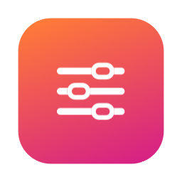
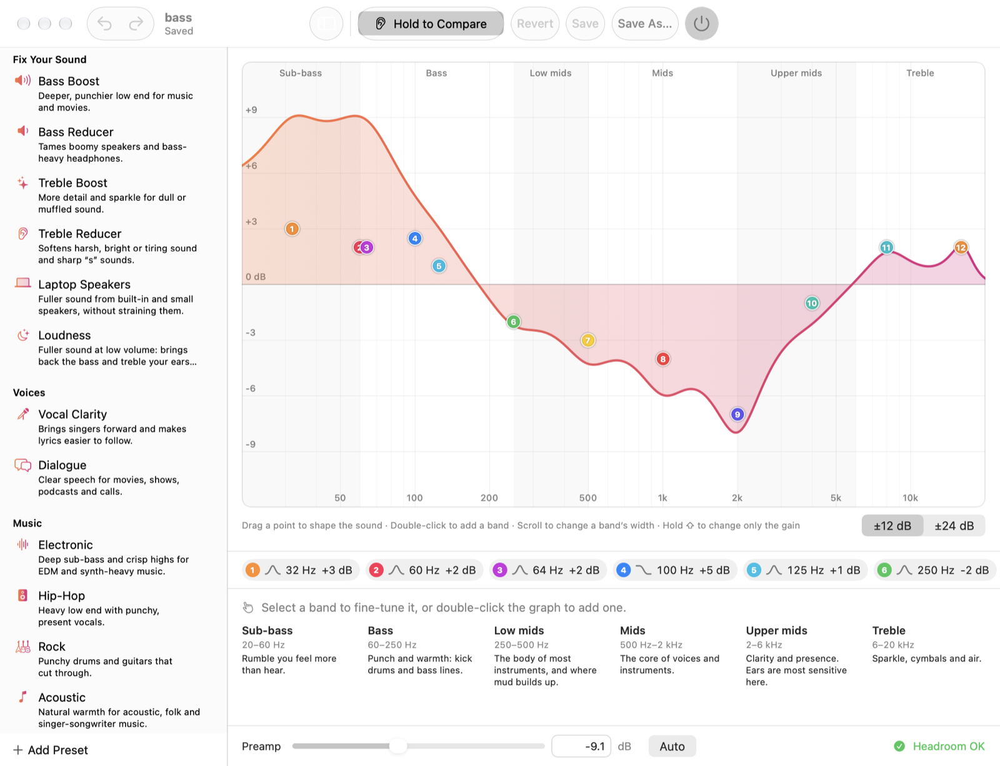
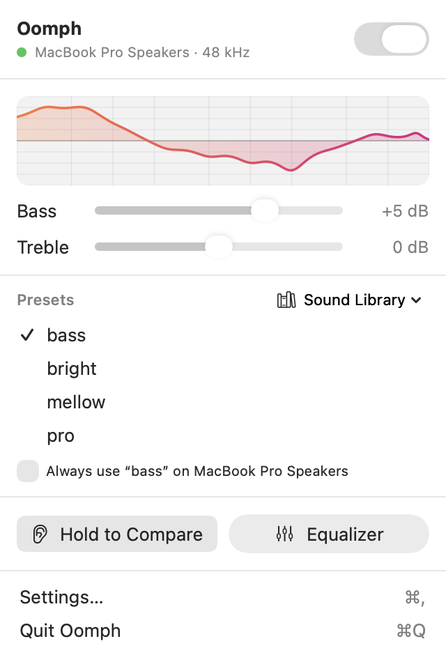

<p align="center">
  
</p>

<h1 align="center">Oomph</h1>

<p align="center">
  <strong>A system-wide equalizer for macOS that lives in your menu bar.</strong><br>
  Make every app sound better, whether you know what a Q factor is or not.
</p>

<p align="center">
  <a href="https://github.com/immdipu/oomph/actions/workflows/ci.yml"></a>
  
  
  <a href="LICENSE"></a>
</p>

<p align="center">
  <picture>
    <source media="(prefers-color-scheme: dark)" srcset="Docs/images/equalizer-dark.png">
    
  </picture>
</p>

Oomph is a native SwiftUI front end for [eqtune](https://github.com/y7nieSEl5/eqtune), the
open-source system-wide EQ engine by y7nieSEl5. eqtune taps your Mac's audio with Core Audio's
process-tap API (no drivers, no kernel extensions) and plays it back through your current output,
so plugging in headphones keeps working the way macOS normally does. Oomph puts all of that in
the menu bar and adds the tools that make an EQ useful to everyone.

## Features

### For everyone

- **Bass and Treble, right in the menu bar.** The two knobs every stereo has, with a live
  preview of the curve.
- **A Sound Library of ready-made tunings**: Bass Boost, Treble Reducer, Laptop Speakers,
  Loudness, Vocal Clarity, Dialogue, Electronic, Rock, Footsteps and more, each with a
  one-line description of what it's for.
- **Built-in presets you can't break.** Tweak Bass Boost and save, and Oomph asks for a name
  and saves *your* version as a new preset ("My Bass Boost"), so the original is always there.
  Presets can be called anything, like "Movie Night".
- **Hold to Compare.** Press and hold to hear your Mac without the EQ, let go to hear it
  again. Quick A/B switching is the surest way to tell whether a change actually sounds better.
- **A preset for each output.** Tick *Always use this preset on AirPods* once, and Oomph
  switches presets whenever macOS switches outputs. In Settings › Devices, pick *No EQ* for
  an output that should sound untouched (an audio interface, say), and one preset for every
  other output.
- **Find your headphones.** Search [AutoEq](https://autoeq.app)'s measured corrections for
  more than 8,000 headphones and earbuds, pick yours, and Oomph adds a preset that evens out
  their sound.
- **Distortion guard.** When boosts would push loud audio past full scale, Oomph says so and
  fixes it in one click.
- **Plain-language guidance.** The graph names each part of the spectrum (sub-bass, bass,
  low mids, mids, upper mids, treble), and every band says what boosting or cutting it does:
  *"Low mids: clears up muddy, boxy sound."*

### For audio nerds

- **Interactive parametric EQ.** Drag a band's point to set frequency and gain, scroll to set
  its width (Q), double-click to add a band, use the arrow keys to nudge and Delete to remove.
  Hold ⇧ to change only the gain.
- **Peak, low-shelf and high-shelf filters**, up to 64 bands, edited at full precision.
  Oomph works from eqtune's exact preset export, not its rounded display.
- **Equalizer APO and AutoEq files.** Import parametric EQ files from Equalizer APO or
  AutoEq; filters eqtune can't play are listed, never silently dropped.
- **Undo and redo** (⌘Z / ⇧⌘Z) for every band and preamp change.
- **Global shortcuts** of your choosing turn the EQ on or off and step to the next or
  previous preset from any app, with a brief on-screen confirmation. No Accessibility
  permission needed.
- **Full preset management**: new, duplicate, rename, delete, export and import (TOML), and
  reset eqtune's own presets to their originals.
- **Preamp with headroom readout** and *Auto* to fit the biggest boost.

<p align="center">
  <picture>
    <source media="(prefers-color-scheme: dark)" srcset="Docs/images/menu-dark.png">
    
  </picture>
</p>

## Requirements

- An Apple Silicon Mac with **macOS 14.2 or later** (eqtune's process taps arrived in 14.2).
- To build from source: **Xcode 16 or later** and the **Rust toolchain** (`cargo`, from
  [rustup.rs](https://rustup.rs)). Oomph builds its own copy of eqtune from source.

## Getting started

### Download

Get `Oomph-<version>.dmg` from the [latest release](https://github.com/immdipu/oomph/releases/latest),
open it and drag Oomph to Applications. Releases are signed with a Developer ID and notarized
by Apple, so Oomph opens like any other app you download.

### Build from source

It takes a couple of minutes.

```bash
git clone --recurse-submodules https://github.com/immdipu/oomph.git
```

```bash
cd oomph && xcodebuild -project Oomph.xcodeproj -scheme Oomph -configuration Release -derivedDataPath build build
```

Then open `build/Build/Products/Release/Oomph.app`, or open `Oomph.xcodeproj` in Xcode and
press Run. Signing uses an "Apple Development" certificate and the team set in the project
(`DEVELOPMENT_TEAM`); set your own team before building on another Mac.

### First launch

On first launch Oomph shows a short setup screen. **Install Audio Engine** installs eqtune's
background process and turns the EQ on. macOS then asks once for permission to capture system
audio; eqtune answers nothing until you respond, so the setup window waits and closes itself
once the EQ is on.

## Using Oomph

| To… | Do this |
|---|---|
| Turn the EQ on or off | The switch at the top of the menu |
| Make it punchier or brighter | Drag **Bass** or **Treble** in the menu |
| Try a ready-made sound | **Sound Library** in the menu, or the library in the Equalizer sidebar |
| Hear the difference | Press and hold **Hold to Compare** |
| Shape the sound precisely | **Equalizer**, then drag the numbered points |
| Change how wide a band is | Hover the graph with the band selected and scroll |
| Correct your headphones | Equalizer › **+** › *Find Your Headphones…* |
| Use a preset on one output | Tick *Always use … on (device)* in the menu, or Settings › Devices |
| Keep the EQ off on one output | Settings › Devices › *No EQ* |
| Switch from any app | Record shortcuts in Settings › Shortcuts |
| Keep your changes | **Save** (⌘S), or **Save As…** for a new preset |

Edits apply live. Like eqtune, Oomph keeps them as *unsaved changes* until you save or reset them,
and marks edited presets with an orange dot. eqtune's presets (Bright, Mellow, Pro) and the Sound
Library's are built in and never change: saving one saves your changes as a new preset instead,
which says which built-in it came from. Oomph remembers the names you give presets in its own
settings; eqtune gets a name made from them ("Movie-Night").

## How it works

```
Oomph (SwiftUI) ── runs ──▶ eqtune CLI ── Unix socket ──▶ eqtune daemon (LaunchAgent)
                                                            │
       system audio ─▶ Core Audio process tap ─▶ biquad EQ + preamp + soft limiter ─▶ your output
```

Oomph does no audio processing of its own. Every action runs an `eqtune` command, and
everything on screen is what eqtune reports back, so the UI can't drift from the engine.

- `Oomph/Core/ProcessEqtuneClient.swift` runs the CLI off the main thread with stdin at
  `/dev/null` and a 5-second timeout, and logs every command with its exit code. Everything goes
  through the `EqtuneClient` protocol, so a Unix-socket client could replace it later.
- `EqtuneStore` keeps only the latest `status`, preset list and active preset. It polls every
  2 seconds while the menu or a window is open and not at all otherwise, and runs CLI calls
  one at a time. Undo/redo sends the band commands that turn the current tuning into the earlier one.
- `AudioOutputs` watches Core Audio's default output so presets can follow devices.
- The frequency-response curve is computed in Swift from the same RBJ biquads eqtune uses, and
  the tests check it against eqtune's own `response` output.
- The parsers are written against real eqtune 0.7.1 output: see
  [Docs/cli-samples.md](Docs/cli-samples.md).

The **Build eqtune engine** phase (`Scripts/build-eqtune.sh`) runs `cargo build --release
--locked` on the `Vendor/eqtune` submodule (pinned to v0.7.1), copies the binary to
`Oomph.app/Contents/Helpers/eqtune`, signs it with the app's identity (Hardened Runtime) and
copies eqtune's licenses to `Contents/Resources/Licenses`. On every launch Oomph compares the
installed engine's version with the bundled one and reinstalls it if they differ (for example
after updating Oomph). The daemon runs from its own copy in
`~/Library/Application Support/eqtune`, so moving Oomph.app doesn't affect it. Oomph runs
`install` from a temporary copy of the engine without a download's quarantine flag: eqtune signs
its copy ad hoc, and Gatekeeper won't start a quarantined program that's signed ad hoc.

## Development

```bash
xcodebuild test -project Oomph.xcodeproj -scheme Oomph -destination 'platform=macOS,arch=arm64' -derivedDataPath build
```

The tests cover the parsers, the response math, AutoEq import and search, the Sound Library's limits
and headroom, and the store's command sequences (band moves, undo, save and discard, device
switching) against a mock eqtune, so they never touch your real EQ.

```
Oomph/
  App/        entry point, app delegate (onboarding, Dock icon, device switching)
  Core/       eqtune client and parsers, the store, models and DSP math, Sound Library,
              AutoEq import and catalog, Core Audio outputs
  UI/         menu bar popover, equalizer window, graph, inspector, settings, onboarding
OomphTests/   Swift Testing suites, with captured eqtune output in Fixtures/
Vendor/eqtune the audio engine (git submodule)
```

Follow the CLI calls as they happen:

```bash
log stream --predicate 'subsystem == "com.dipu.eqtunebar"'
```

See [CONTRIBUTING.md](CONTRIBUTING.md) for conventions and how to propose changes.

## FAQ

**Does Oomph change my output device?** No. eqtune taps the audio and plays it back to whatever
output macOS is using, so AirPods, Bluetooth speakers and the headphone jack switch as usual.

**What does it cost in battery?** Real-time processing always uses some power. By default the
engine pauses while nothing is playing and in Low Power Mode (Settings › Engine).

**Why does macOS ask for audio-capture permission again?** `eqtune install` signs the daemon
ad hoc, so each new engine version looks like a new app to macOS. That happens only after an
Oomph update that ships a new eqtune.

**Can I still use eqtune from Terminal?** Yes, and Oomph shows the changes. Install the CLI
with `cargo install --locked eqtune`.

**Where are my presets?** In `~/Library/Application Support/eqtune/config.toml`, managed by
eqtune. Uninstalling the engine (Settings › Engine) keeps them.

## Known limitations

- **eqtune's text output is not a stable API.** Oomph parses `status`, `presets`,
  `preset-show` and `preset-export` as eqtune 0.7.x prints them. If a future eqtune changes the
  format, Oomph shows "couldn't read eqtune's output" with the raw text instead of guessing.
- **Discarding edits restarts the engine for a moment.** eqtune discards unsaved edits only
  through `eqtune off`'s own prompt, so Oomph answers it and turns the EQ back on.
- **Some preset changes need saved edits.** eqtune refuses to import, duplicate, rename, delete
  or reset presets while any preset has unsaved edits; Oomph asks you to save or discard first.
- **Presets follow outputs only while Oomph runs.** Turn on Launch at Login in Settings.
- **eqtune handles one request at a time** and can be busy for a few seconds while its audio
  engine starts. A command can then report "eqtune was busy"; the next refresh shows what happened.
- **eqtune never clears `last error`.** Oomph shows a warning only while the EQ should be running
  and isn't (auto-off pauses don't count).
- **Not yet:** a spectrum analyzer, per-app EQ, Intel builds.

## Contributing

Bug reports, ideas and pull requests are welcome. Please read
[CONTRIBUTING.md](CONTRIBUTING.md) and the [Code of Conduct](CODE_OF_CONDUCT.md), and report
security issues privately as described in [SECURITY.md](SECURITY.md).

## License

Oomph is released under the [MIT License](LICENSE).

eqtune is © its authors and licensed under MIT or Apache-2.0. Oomph doesn't copy its code: it
builds it from the `Vendor/eqtune` git submodule, and the app bundle includes both license
texts in `Contents/Resources/Licenses`.
